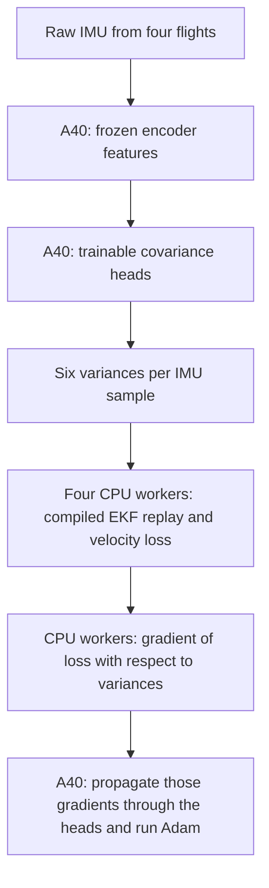

# Why EKF training was slow, and what made it faster

Written on 19 November 2026, Singapore time. Measurements below come from the
completed A40 benchmark, PBS job **1586065**.

**Implementation update:** that benchmark and completed job 1589404 used the
older no-height cutoff policy described below. The code now implements
clean Vicon-Z height updates before and after cutoff at each estimate (standard deviation
0.1 m), with differentiable covariance propagation throughout replay. The
nominal-only post-cutoff shortcut has been removed. The measured timings below
are historical and do not include this additional work. Existing results and
ONNX exports have not been relabelled as height-trained models. See the
[current integration guide](differentiable_eskf.md) for the new policy.

The main bottleneck was replaying the EKF and computing gradients through that
replay. The filter performs thousands of small operations in time order, and
the original execution path handled each operation separately. Compiling the
repeated filter step, including its backward pass, produced the largest measured
improvement.

The two benchmark epochs took **7 minutes 3 seconds** and **6 minutes 11 seconds**,
including validation. The earlier run took about **31 minutes 37 seconds** per
epoch. On a controlled comparison using the same flight and covariance inputs,
EKF replay became **8.6 times faster**.

## 1. What was the blocker?

EKF training has two different kinds of work:

1. AirIMU reads IMU data and predicts six variances per sample: accelerometer
   x/y/z and gyroscope x/y/z.
2. The EKF uses those variances while replaying the flight. The resulting
   horizontal velocity error supplies the training loss. Backpropagation then
   works through the EKF to determine how the covariance-head weights should
   change.

The second part dominated runtime. In the reference implementation, every IMU
step involves small matrix operations, quaternion calculations and, before
cutoff, three sequential measurement updates. The state error covariance is
only **15 by 15**. Each step depends on the previous step, so the timestamps of
one flight cannot simply be processed independently.

PyTorch's original, uncompiled execution is called **eager execution**. It runs
each tensor operation separately and records the operations needed for
backpropagation. Repeating this over a flight creates substantial dispatch
overhead and a long gradient calculation.

The same-flight measurement showed where time went:

| Work | Original eager replay | Compiled replay | Measured speedup |
| --- | ---: | ---: | ---: |
| Forward: calculate the trajectory and loss | 40.40 s | 9.91 s | 4.1× |
| Backward: calculate gradients with respect to predicted variances | 110.43 s | 8.22 s | 13.4× |
| Complete replay call, including surrounding overhead | 156.97 s | 18.20 s | **8.6×** |

**The backward pass was the largest measured cost.** It took about 110 seconds
of the original 157-second replay. Making network inference faster alone would
leave this cost largely intact.

These are component timings and code-based findings. We did not collect an
operator-by-operator GPU profile, so we cannot assign an exact percentage to
each individual source of overhead.

## 2. The main new change: compile a complete filter step

We added [ekf/compiled.py](../ekf/compiled.py). It uses `torch.compile` to prepare
optimized versions of three repeated operations:

- Prediction followed by the position XY, velocity XY and yaw updates.
- Prediction without a measurement update.
- Nominal state propagation without covariance propagation, for the existing
  post-cutoff training behavior.

The important unit is **one filter step**, rather than the entire flight. The
flight still runs in chronological order. Within a step, the compiler can
combine operations and optimize both the forward calculation and its backward
calculation.

The compiled path also reduces repeated work:

- It reuses rotation, quaternion increment and Jacobian calculations within
  prediction.
- Process noise is diagonal, so it scales the columns of the noise map instead
  of constructing and multiplying a dense diagonal noise matrix. This computes
  the same noise contribution.
- It splits IMU and variance tensors into rows before entering the replay loop.
- It prepares fixed observation rows, observed yaw and timestamp scheduling
  outside the repeated filter calculations.
- On CUDA, it collects Cholesky factorization status on the device and checks
  it at the end of the flight. This avoids forcing the CPU to wait after every
  measurement update. Invalid factorizations still cause replay to fail.

The fast path supports the aligned TLab observation schedule: position XY,
velocity XY and yaw at each aided timestamp, in that order. It explicitly
rejects unsupported schedules. The general implementation remains available as
`--replay-backend eager` for asynchronous measurement timestamps.

Compilation costs time when a kernel variant is first used. That cost is then
reused across many steps. Launchers provide a job-local compiler cache and limit
compiler threads to avoid competing excessively with replay workers.

## 3. Why the EKF runs on CPU while AirIMU runs on the A40

We tested both devices. For the warmed synthetic replay, including forward and
backward calculations:

| Device | Time for the same 501-sample replay |
| --- | ---: |
| One CPU replay worker | **0.332 s** |
| NVIDIA A40 CUDA replay | **1.324 s** |

The A40 path worked, but this particular replay was about **four times slower**
than a single CPU worker. This is consistent with the cost of launching many
small, dependent GPU operations outweighing their calculation time. A large GPU
helps most when operations contain enough parallel work; these small filter
matrices do not provide much work per step.

We therefore use the measured faster arrangement:

- **A40:** frozen network feature extraction, trainable covariance-head
  prediction, covariance-head backward pass and Adam updates.
- **Four CPU processes:** four independent flight replays, each using one
  PyTorch thread and the compiled filter step.



Each worker returns how its flight loss changes with each predicted variance.
The main process uses those derivatives to backpropagate through the covariance
heads. This is the chain rule split across processes; moving gradient arrays
between processes does not remove the covariance-head training signal.

The benchmark's device selector estimates whether GPU replay could beat four
CPU workers using these synthetic timings. Actual epoch timings provide the
end-to-end check. This result applies to the implementation and hardware tested;
a filter that batches many flight states together on the GPU would need its own
benchmark.

Low GPU utilization is therefore expected with this arrangement. The remaining
heavy work is on the CPU replay workers. GPU utilization alone does not measure
training throughput.

The dedicated benchmark and training/export launchers request **8 CPUs and
64 GB RAM**, compared with 36 CPUs and 250 GB in the general joint-workflow
launcher. Reserving more cores does not automatically accelerate one sequential
flight. Using additional replay workers requires independent flights and enough
memory for each flight's gradient calculation. Four workers are the validated
configuration here; we have not exhaustively tested every worker count.

## 4. Other changes and supporting optimizations

It matters which features were new. **The earlier 31-minute run already used
four CPU workers, batches of four flights and a frozen-feature cache.** Those
features support the faster setup, but introducing them cannot explain the
new improvement over that run.

| Change or feature | What it saves | Status relative to the 31-minute run |
| --- | --- | --- |
| Compiled filter forward and backward | Repeated operation dispatch and gradient-calculation overhead | New; largest demonstrated improvement |
| Worker cache of prepared flights | Repeated file loading, alignment and preparation when a flight is reused | New; up to 16 flights per worker |
| Prepared aligned observation rows | Rebuilding fixed observations and scheduling work | Added with compiled replay; reused with cached flights |
| Frozen encoder-feature cache | Re-running the unchanged CNN/GRU and correction features every epoch | Already present; retained |
| Batched GPU covariance heads | Separate head calls for each flight | Already present; retained |
| Next-batch feature preparation during CPU replay | Idle time between preparation and replay | Already present; retained |
| One thread per replay worker | Multiple processes each trying to occupy all CPU threads | Already present; retained |
| Spawned worker processes and contiguous NumPy transfers | Inherited CUDA/BLAS state problems and many individual tensor transfers | Already present; retained |
| Validation without gradients; omitted covariance history in training | Unneeded gradient graphs and large saved state histories | Already present; retained |

Only **frozen** features and fixed flight inputs are cached. Trainable covariance
predictions are recomputed using the current head weights. A previous flight's
training graph is released after use.

The feature cache budget is **512 MiB**. In the successful benchmark it held
about **143.8 MiB** of features. The second epoch reported 105 feature-cache hits
and no additional misses, corresponding to the 82 training plus 23 validation
flights. Worker flight caches are separate and can evict flights independently.

## 5. Execution blockers that also had to be fixed

These fixes made the optimized path run reliably. They should be distinguished
from the filter's original performance bottleneck.

**Mixed PyTorch and Triton packages.** User-installed packages could override
the container's compiler packages, producing an incompatible environment and an
`AttrsDescriptor` import error. The launcher now uses
[scripts/container_python.py](../scripts/container_python.py) with Python's
automatic user-site loading disabled. Container packages take priority, while
additional dependencies remain available. The successful benchmark used
PyTorch `2.5.0+cu124`. Compatibility handling for `typing_extensions` and protobuf
also allows the existing W&B dependencies to import in this environment.

**A CUDA compilation failure during validation.** A quaternion-conjugation
expression caused the PyTorch/Triton compiler to generate an invalid scalar
broadcast and fail with `'constexpr' object has no attribute 'type'`. We replaced
it with the equivalent identity that the inverse rotation matrix is the
transpose of the rotation matrix. The tests exercise CUDA backward calculations
and validation with gradients disabled, covering the failing mode.

These were software execution blockers, rather than evidence that the A40 ran
out of memory or could not execute an EKF.

## 6. What the full benchmark proved

The successful benchmark ran on **GN-A40-004**, with one NVIDIA A40 and an
allocation of **8 CPUs and 64 GB RAM**.

| Run | Training flights | Validation flights | Epoch time |
| --- | ---: | ---: | ---: |
| Earlier eager run, epoch 22 | 51 | 14 | 31m 37s |
| Compiled benchmark, epoch 1 | 82 | 23 | 7m 03s |
| Compiled benchmark, epoch 2 | 82 | 23 | **6m 11s** |

Every epoch time above includes training and validation. The second new epoch
took about **5.1 times less time**, despite processing more flights. However,
the dataset and starting checkpoint differed between runs, and the old node's
CPU hardware was not controlled in this comparison. Use the **8.6× same-flight
comparison** to judge the measured replay implementation improvement.

The two epoch timers total **13m 13s**. The complete PBS job took **22 minutes**
because it also ran correctness tests, CPU/GPU benchmarks, compilation and an
eager reference replay. It is incorrect to divide those 22 minutes by two and
call the result the training epoch time.

The following checks passed:

- All four compiled-replay regression tests, including CPU/CUDA gradient and
  validation checks.
- Same-flight loss agreement to an absolute difference of about `1.40e-13`.
- Maximum absolute difference in variance gradients of about `9.24e-10`.
- Two complete training and validation epochs, with 21 Adam updates per epoch.

The process high-water memory values in `replay_benchmark.json` are cumulative
within a process. Since eager replay ran first, those values do **not** establish
a separate compiled-versus-eager memory reduction.

## 7. Training behavior and the cutoff limitation

The fast replay retains 64-bit EKF calculations (`Float64`), chronological IMU processing,
the same measurement-update order and the horizontal velocity loss on
`[cutoff + 5 s, cutoff + 25 s]`. It retains gradients through the aided history;
it does not replace full replay with short training windows or skip IMU samples.
Four-flight batches average complete-flight losses before an Adam update. The
last, smaller batch uses its actual flight count. The older comparison run used
the same four-flight batch setting.

Initial flight-specific biases, minimum covariance floors and variance logging
are also retained. The variance floors are `1e-4` for acceleration and `1e-8` for
gyro. There are **no maximum covariance limits**. Each epoch prints and saves
sample-weighted average, minimum and maximum predicted variances for each axis,
separately for training and validation. These values are IMU variances, rather
than the EKF's 15-by-15 state covariance. These configuration and logging changes
are not credited as the cause of the measured speedup.

**The completed benchmark and 20-epoch job used the old cutoff behavior.** After
cutoff, training propagated the nominal state without further Vicon updates and
without propagating state covariance. The evaluator still returned covariance
histories. The training shortcut already existed before compiled replay.

Consequently, their horizontal velocity loss trained covariance predictions made
**before** cutoff. Predicted variances at or after cutoff had zero direct
gradient from that loss. Matching the old reference gradient did not establish
a training signal after cutoff.

Height-only updates and continuous post-cutoff covariance propagation were
outstanding when that benchmark ran. They are now implemented in the reference
and compiled paths, with gradient and covariance-head regression tests. The
performance benchmark must be repeated: the historical 6m 11s measurement does
not include those additions, and the completed 20-epoch model predates them.

## 8. Files, evidence and running the optimized setup

| File | Purpose |
| --- | --- |
| [ekf/compiled.py](../ekf/compiled.py) | Compiled filter steps and aligned-observation checks |
| [ekf/parallel.py](../ekf/parallel.py) | Replay workers, flight cache and returned variance gradients |
| [ekf/runner.py](../ekf/runner.py) | Feature cache, GPU head batches and optimizer coordination |
| [ekf/training.py](../ekf/training.py) | Frozen feature extraction and covariance-head training |
| [train_eskf.py](../train_eskf.py) | Training entry point, provenance and epoch statistics |
| [scripts/container_python.py](../scripts/container_python.py) | Container package priority and dependency compatibility |
| [tests/test_compiled_eskf.py](../tests/test_compiled_eskf.py) | Forward, backward and validation regression checks |
| [benchmarks/benchmark_eskf.py](../benchmarks/benchmark_eskf.py) | CPU/GPU timing and real-flight reference comparison |
| [airimu_ekf_benchmark.pbs](../airimu_ekf_benchmark.pbs) | Correctness checks and two-epoch benchmark |
| [airimu_ekf_train_export.pbs](../airimu_ekf_train_export.pbs) | Prepared-input training followed by inference, evaluation and export |

The completed benchmark's source evidence is available here:

- [PBS output](../airimu_ekf_bench.o1586065).
- [Replay benchmark and gradient comparison](../experiments/20261118_215734_SGT_job1586065_ekf_benchmark/replay_benchmark.json).
- [Epoch metrics](../experiments/20261118_215734_SGT_job1586065_ekf_benchmark/training/metrics.jsonl).
- [Checkpoint, runtime and flight provenance](../experiments/20261118_215734_SGT_job1586065_ekf_benchmark/training/eskf_metadata.json).
- [Earlier run's epoch metrics](../experiments/20261115_234250_SGT_job1559873/joint_ekf/ekf_training/metrics.jsonl).

In the validated container environment, the main runtime settings are:

```bash
python3 -s -u scripts/container_python.py train_eskf.py \
  --config /path/to/matching/stage2.conf \
  --ckpt /path/to/stage2/best_model.ckpt \
  --dataset-config /path/to/dataset.conf \
  --sensor-metadata-root /path/to/initial_sensor_biases \
  --output /path/to/new/ekf_training \
  --device cuda:0 --ekf-device cpu \
  --replay-backend compiled --replay-workers 4 --flight-batch-size 4 \
  --cpu-threads 1 --feature-cache-mb 512 --epochs 20 --lr 1e-5
```

The new 20-epoch job uses this arrangement, starting from the October Stage 2
checkpoint selected by the user. The two-epoch performance benchmark instead
started from the earlier `20261116_151808_SGT_bias_no_cov_limits` Stage 2 model.
Its timings are measured evidence for that benchmark, rather than completed
results for the new checkpoint.
